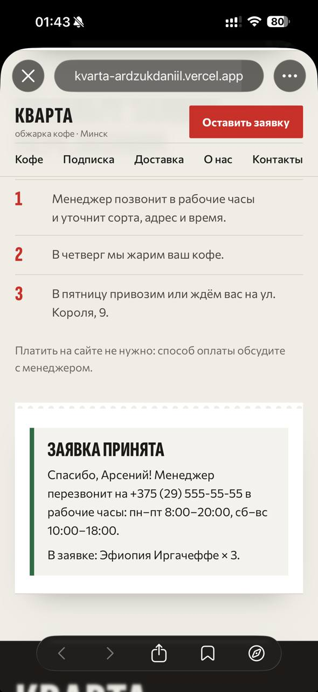
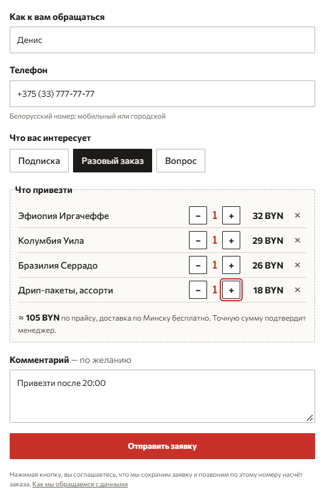
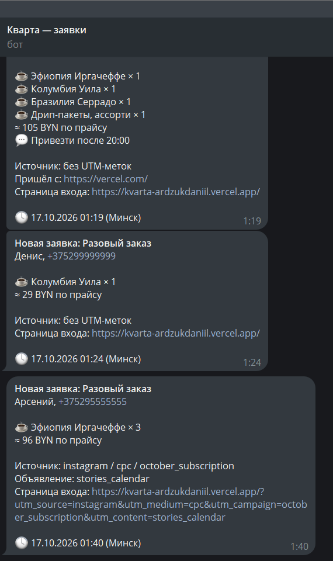

# «Кварта» — лендинг для обжарки кофе

Тестовое задание: лендинг для небольшой минской обжарки с рабочей формой заявки.

| | |
|---|---|
| **Сайт** | https://kvarta-ardzukdaniil.vercel.app |
| **Лог работы с ИИ** | [`docs/conversation-2026-10-17-015428.txt`](docs/conversation-2026-10-17-015428.txt) — экспорт сессии Claude Code (личные данные заменены на `XXX`) |
| **Lighthouse, мобильный** | 99 / 100 / 100 / 100 — [скриншот](docs/lighthouse-mobile.png), [отчёт](docs/lighthouse-mobile.report.html) |
| **Как устроено** | [`docs/TECH.md`](docs/TECH.md): стек, форма, хранилище, допущения, запуск |
| **Дизайн** | [`DESIGN.md`](DESIGN.md) и [`previews/`](previews/) — четыре варианта стиля, из которых я выбирал |

  
  
  

Слева заявка с телефона, в центре форма, справа та же заявка в Telegram менеджера: с источником рекламы и объявлением.

## Стек и почему

Статичный HTML/CSS/JS и один эндпоинт `POST /api/lead` на **Python (FastAPI)**, всё на **Vercel**. Next.js был бы плюсом, но Python я знаю лучше и хотел код, который могу сам объяснить. Заявки хранятся в **Turso** (SQLite в облаке): обычный файл SQLite на Vercel не подходит, файловая система там временная. Каждая новая заявка дублируется менеджеру в **Telegram**.

Все требования к форме выполнены: белорусский номер, защита от повтора и двойного клика (6 одновременных запросов на проде дали одну заявку), источник рекламы, понятные ошибки. Как именно — в [TECH.md](docs/TECH.md).

## Что делал я, а что ИИ

Работал в Claude Code со своим скиллом `web-design-studio`. Это процесс дизайн-студии: исследование ниши, варианты стиля, вёрстка, проверка скриншотами, ревью отдельным агентом.

- **Решал я:** стек и хостинг; выбор из четырёх стилей; структуру страницы и допущения; какие номера принимать; всё, что менялось после моего просмотра сайта (тексты, навигация, выбор кофе, подписка, «Вопрос»); где предложение ИИ противоречит ТЗ; аккаунты, деплой, Turso, Telegram и проверку на своём телефоне.
- **Делал ИИ:** исследование конкурентов и превью стилей, вёрстку, API и 69 тестов, подбор фото, проверки в браузере, замер Lighthouse.

## Где ИИ ошибся и как это заметили

- **Выдумывал факты:** «дата обжарки на каждой пачке», «оплата при получении». В брифе этого нет. Поймали вычиткой по брифу.
- **Делал понятно себе, а не посетителю.** Я открыл сайт как посетитель: заголовок не говорил, что это кофе, календарь был похож на выбор даты, у кнопок было четыре разных названия, а «В пятницу — у вас» обещало доставку любого заказа в ближайшую пятницу. Переделали; под слоганом теперь условие «заявка до конца среды».
- **Сказал «готово», не проверив на экране.** Блок заказа при «Вопросе» должен был скрываться. ИИ проверил атрибут в коде, а на экране блок оставался. Заметил я.
- **Предложил правку против ТЗ:** отклонять заявку с лишними данными. Я спросил, не противоречит ли это ТЗ. Противоречило: заявки бы терялись.
- **Терял данные при повторе номера:** вопрос, а через минуту заказ с того же номера — заказ считался дублем. Теперь первая заявка дополняется.
- **Чужой адрес сайта.** ИИ прописал везде `kvarta-coffee.vercel.app`, а по нему открывался чужой сайт. Потом предложил имя `kvarta-coffee-landing`, тоже занятое. Поймали на ревью перед деплоем: запрос к адресу вернул чужой сайт.

Остальные ошибки

- «Подписка выгоднее» — неправда: две пачки Бразилии стоят 52 BYN, подписка 54. Продаём удобством.
- Длинная UTM-метка роняла всю заявку; маска телефона превращала `+7 912…` в `+375 (79)…`.
- В лог писались имя, телефон и URL с токеном Telegram; CSV-выгрузка была уязвима к формулам Excel. Поймал security-review.
- ИИ закоммитил код с упавшими тестами: проверял код возврата не той команды.
- Тестовые заявки на проде ИИ отправлял на выдуманные, но правдоподобные номера. Я остановил.

## Чего нет и что сделал бы иначе

- Нет фото мастерской, телефона и Instagram клиента: в брифе их нет, на сайте заглушки. Фото с Wikimedia Commons, авторы в подвале.
- Тарифы подписки (для дома, офиса, кофейни) предложил бы клиенту, но на сайт не ставил: придумывать цены за клиента нельзя.
- Форма работает только с JavaScript; для менеджера сделал бы страницу заявок со статусами (сейчас Telegram и CSV); политику данных должен проверить юрист.
